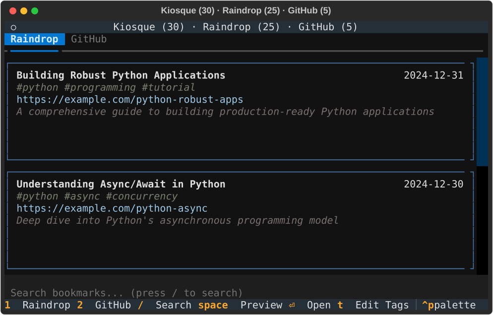

# TUI Guide

Complete reference for Kiosque's Terminal User Interface (TUI).

## Overview

The Kiosque TUI provides a unified interface for managing bookmarks from multiple sources:

- **Raindrop.io** - Personal bookmark manager with tags and collections
- **GitHub Stars** - Your starred repositories with README previews

## Launching the TUI

```bash
# Default: launches TUI
kiosque

# Or explicitly
kiosque tui
```

## Interface Layout



The TUI features:

- **Header**: Shows window title with total entry counts for each tab
- **Tabs**: Switch between Raindrop and GitHub Stars (`1`/`2`)
- **Entry List**: Scrollable list of bookmarks with:
  - Title (bold, first line)
  - Date (right-aligned)
  - Tags/topics (gray, italic)
  - URL (blue)
  - Brief description/excerpt
- **Search Input**: Filter entries by typing `/`
- **Footer**: Quick reference for key bindings

## Navigation

### Movement

| Key        | Action                   |
| ---------- | ------------------------ |
| `↑` / `k`  | Move up one entry        |
| `↓` / `j`  | Move down one entry      |
| `Ctrl+u`   | Scroll up 5 entries      |
| `Ctrl+d`   | Scroll down 5 entries    |
| `g`        | Jump to top              |
| `G`        | Jump to bottom (Shift+g) |
| `PageUp`   | Scroll up one page       |
| `PageDown` | Scroll down one page     |

### Tab Switching

| Key   | Action                     |
| ----- | -------------------------- |
| `1`   | Switch to Raindrop tab     |
| `2`   | Switch to GitHub Stars tab |
| `Tab` | Cycle through tabs         |

## Search and Filtering

### Activating Search

| Key      | Action                     |
| -------- | -------------------------- |
| `/`      | Activate search bar        |
| `Esc`    | Clear search / Exit search |
| `Ctrl+C` | Clear search / Exit search |

### Search Behavior

- **Debounced** - Waits 300ms after you stop typing before filtering
- **Case-insensitive** - Searches regardless of letter case
- **Multi-field** - Searches across:
  - Title
  - URL
  - Tags (Raindrop)
  - Topics (GitHub)
  - Description
  - Language (GitHub)
  - Repository name (GitHub)

**Example searches:**

- `python` - Finds all entries with "python" in any field
- `#tutorial` - Finds entries tagged "tutorial"
- `github.com` - Finds all GitHub URLs

### Search Mode Restrictions

- **Tag editing disabled** - When in tag edit mode (press `t`), search is automatically disabled
- **Single mode active** - Cannot search while editing tags

## Entry Actions

### Common Actions (All Tabs)

| Key           | Action          | Description                          |
| ------------- | --------------- | ------------------------------------ |
| `Space`       | Preview         | Open article, README or media picker |
| `Enter` / `o` | Open in browser | Opens URL in default browser         |
| `c`           | Copy URL        | Copy entry URL to clipboard          |
| `Esc`         | Close modal     | Exit preview modal                   |

### Raindrop-Specific Actions

| Key | Action         | Description                                        |
| --- | -------------- | -------------------------------------------------- |
| `d` | Delete         | Permanently delete bookmark                        |
| `e` | Archive        | Move bookmark to archive                           |
| `t` | Edit tags      | Enter tag editing mode                             |
| `s` | Star on GitHub | Star GitHub repos (only for GitHub URLs)           |
| `m` | Media formats  | Find downloadable media, including embedded videos |

### GitHub-Specific Actions

| Key     | Action         | Description                     |
| ------- | -------------- | ------------------------------- |
| `u`     | Unstar         | Remove star from repository     |
| `Space` | Preview README | View repository README in modal |

## Tag Editing (Raindrop)

### Entering Tag Mode

1. Navigate to a Raindrop bookmark
2. Press `t`
3. Tag edit field appears

### Input Formats

The tag editor accepts multiple formats:

**Space-separated:**

```
python programming tui
```

**Comma-separated:**

```
python, programming, tui
```

**Hashtags:**

```
#python #programming #tui
```

**Mixed:**

```
python, #programming tui
```

All formats are normalized to a consistent tag list.

### Saving/Canceling

| Key     | Action                      |
| ------- | --------------------------- |
| `Enter` | Save tags and exit tag mode |
| `Esc`   | Cancel and exit tag mode    |

### Important Notes

- **Search disabled** - While editing tags, search is automatically disabled
- **Immediate sync** - Tags are synchronized with Raindrop.io on save
- **Visual feedback** - Tags appear as `#tag1 #tag2` in the entry display

## Preview Modal

### Features

- **Markdown rendering** - Articles and READMEs displayed with formatting
- **Syntax highlighting** - Code blocks highlighted
- **Scroll support** - Navigate long documents
- **Frontmatter display** - Shows metadata (title, date, author)

### Modal Controls

| Key        | Action               |
| ---------- | -------------------- |
| `↑` / `k`  | Scroll up            |
| `↓` / `j`  | Scroll down          |
| `PageUp`   | Scroll up one page   |
| `PageDown` | Scroll down one page |
| `g`        | Jump to top          |
| `G`        | Jump to bottom       |
| `Esc`      | Close modal          |

### Known Issue

**Link Navigation Error**: Clicking links in preview modals opens them in the browser correctly, but also triggers a `FileNotFoundError` due to Textual framework trying to navigate to the URL as a local file. This is a Textual bug, not a Kiosque issue. The link still opens correctly - just ignore the error message.

## Media Previews and Downloads

Press `Space` on a YouTube, ARTE or other yt-dlp-supported bookmark to open
its format picker. Article and GitHub README previews remain available as before.
Unsupported article previews show “No preview available” rather than opening the
media picker. Press `m` on any Raindrop entry to explicitly search for media,
including videos embedded in article pages or pages without a dedicated yt-dlp
extractor. Discovery uses the **yt-dlp Python library**, not a command-line wrapper.

Choose a video/version, audio track and any subtitle languages/formats. Labels
include the format ID, codecs, quality, language, version notes and file size when
available. ARTE's original, dubbed and accessibility version notes are preserved.
Combined video/audio versions keep their own soundtrack; pair a separate audio
track only with a video-only format. To download audio alone, select **No video**;
combined versions can also be selected for audio extraction. For subtitles alone,
select **No video** and **No audio**. `Enter` or a click toggles a subtitle choice.
As with article/README previews, pressing `Space` again closes the picker from any
control.

Actions appear in the same clickable key-hint footer as the main window:
`Ctrl+s` downloads, `r` refreshes formats, `x` cancels the current job and `Space`
closes the preview. Unavailable actions remain visible but dimmed.

Click **Download** in the footer or press `Ctrl+s`. Separate tracks merge into MKV without
re-encoding, and subtitles are saved as separate sidecar files. Different media
versions and subtitle variants receive distinct filenames. Closing the picker
with `Space`, `Escape` or **Close** leaves downloads running; reopen it to see progress or
click **Cancel job**. Quitting Kiosque requests cancellation of active jobs.
Cancellation is cooperative: network extraction or an ffmpeg operation already
running may take time to reach its next cancellation checkpoint.

### Format Cache

Format/subtitle metadata is cached in memory and in the platform's Kiosque cache
directory under `media/`. Reopening a preview uses cached choices immediately,
even across Kiosque restarts. Listings are fresh for six hours by default; older
listings refresh in the background while retaining your selection. Press `r` or
click **Refresh** to explicitly reload choices. Cache age/refresh errors appear in
the picker. The cache holds up to 128 listings and is scoped to the yt-dlp version
and proxy configuration.

The cache stores display metadata and selection IDs, **not cookies, credentials
or signed stream URLs**. Download URLs are refreshed when a job starts. If an
exact selected track disappeared, the download fails rather than silently
substituting a different version.

### Destination and Dependencies

The default download directory is `~/Movies/kiosque` on macOS. On Linux, Kiosque
uses the XDG videos directory when configured, otherwise `~/Videos/kiosque`.
Other platforms use `~/Videos/kiosque`. Override the destination and cache
freshness in `kiosque.conf`:

```ini
[media]
download_dir = ~/Movies/kiosque
cache_ttl = 21600
```

`cache_ttl` is in seconds; zero always refreshes cached listings in the background.
The destination is shown in the picker and created on the first download.

Install **ffmpeg** (including ffprobe) for track merging and extracting audio from
combined versions. Full YouTube support also needs a supported JavaScript runtime
such as **Deno**; yt-dlp's default Python extras include its EJS support package.
On macOS, `brew install ffmpeg deno` provides the external tools.

Configured `[proxy]` settings also apply to media discovery/downloads. Browser
cookies are not read automatically. Geo-blocking, expired broadcast rights,
authentication and DRM can limit availability. This initial version accepts only
single on-demand videos, not playlists, channels, live or upcoming streams.

## General Actions

### Application Control

| Key      | Action                     |
| -------- | -------------------------- |
| `r`      | Refresh current tab        |
| `q`      | Quit application           |
| `Ctrl+C` | Quit application (force)   |
| `?`      | Show help (if implemented) |

### Refresh Behavior

- **Current tab only** - Press `r` to refresh active tab
- **Shows loading indicator** - Visual feedback during refresh
- **Preserves position** - Attempts to maintain scroll position

## Window Title

The window title shows real-time counts:

```
Kiosque (42) · Raindrop (30) · GitHub (12)
```

- **Total count** - `(42)` - Combined entries across all tabs
- **Per-tab counts** - `Raindrop (30)` - Entries in each tab
- **Live updates** - Updates after delete, archive, refresh

## Progressive Loading

The TUI uses progressive loading for better responsiveness:

1. **Raindrop loads first** - Appears immediately
2. **100ms delay** - Brief pause
3. **GitHub loads** - Fetched in background
4. **Non-blocking** - UI remains responsive during load

## Data Sources

### Raindrop.io

**Configuration required:**

```ini
[raindrop.io]
token = your_raindrop_api_token
```

**Features:**

- Browse all bookmarks with metadata
- Preview articles with markdown rendering
- Archive bookmarks
- Delete bookmarks
- Edit tags inline
- Star GitHub repositories found in bookmarks

See [Raindrop Integration](../integrations/raindrop.md)

### GitHub Stars

**Configuration required:**

```ini
[github]
token = ghp_your_github_personal_access_token
```

**Features:**

- Browse starred repositories
- Preview README files
- Unstar repositories
- View star count, language, topics
- Search by name, description, topics

See [GitHub Stars Integration](../integrations/github.md)

## Tips and Tricks

### Efficient Navigation

- **Use vim keys** - `j`/`k` are faster than arrow keys
- **Jump to ends** - `g` and `G` to quickly reach top/bottom
- **Page scrolls** - `Ctrl+d`/`Ctrl+u` for faster navigation
- **Tab switching** - Use `1`/`2` for quick tab switching

### Effective Searching

- **Start broad** - Search for general terms, then refine
- **Use tags** - `#tag` format for precise tag matching
- **Language filter** - Search "Python", "Rust", etc. for GitHub repos
- **Wait for debounce** - Let search complete (300ms after typing)

### Tag Management

- **Consistent format** - Use lowercase tags for consistency
- **Descriptive tags** - Use meaningful tags: `#tutorial` not `#tut`
- **Multiple tags** - Combine tags for better organization
- **Review regularly** - Edit tags to keep them current

### Performance

- **Search debouncing** - Prevents lag while typing (300ms delay)
- **Progressive loading** - UI stays responsive during data fetch
- **Lazy preview** - README/articles only loaded on preview

## Troubleshooting

### Tab doesn't appear

**GitHub tab missing:**

- Verify `github` token is configured
- Check token hasn't expired
- Ensure `[github]` section exists in config

**Raindrop tab empty:**

- Verify `raindrop.io` token is configured
- Test token validity: `curl -H "Authorization: Bearer TOKEN" https://api.raindrop.io/rest/v1/user`

### Search not working

- Search is debounced - wait 300ms after typing
- Cannot search while editing tags (press `Esc` to exit tag mode)
- Clear search with `Esc` and try again

### Preview shows errors

- Some sites may not be accessible
- GitHub README might be missing
- Network connectivity issue
- Try opening in browser with `Enter` instead

### Actions not responding

- Ensure correct tab is active
- Some actions only work on specific tabs (e.g., `t` for Raindrop only)
- Try refreshing the tab with `r`

### Slow performance

- Large number of bookmarks (1000+) may slow loading
- GitHub API rate limits (5000/hour with token)
- Network latency
- Try searching to filter entries

## Keyboard Shortcuts Quick Reference

### Essential

| Key     | Action          |
| ------- | --------------- |
| `/`     | Search          |
| `Space` | Preview         |
| `Enter` | Open in browser |
| `q`     | Quit            |
| `r`     | Refresh         |

### Navigation

| Key   | Action      |
| ----- | ----------- |
| `j/k` | Up/Down     |
| `g/G` | Top/Bottom  |
| `1/2` | Switch tabs |

### Raindrop

| Key | Action             |
| --- | ------------------ |
| `t` | Edit tags          |
| `e` | Archive            |
| `d` | Delete             |
| `s` | Star (GitHub URLs) |

### GitHub

| Key     | Action         |
| ------- | -------------- |
| `u`     | Unstar         |
| `Space` | Preview README |

## See Also

- [Raindrop Integration](../integrations/raindrop.md) - Raindrop.io setup and features
- [GitHub Stars Integration](../integrations/github.md) - GitHub Stars setup and features
- [Bookmark Management](bookmark-management.md) - Overview of bookmark features
- [Configuration](../getting-started/configuration.md) - API token setup
